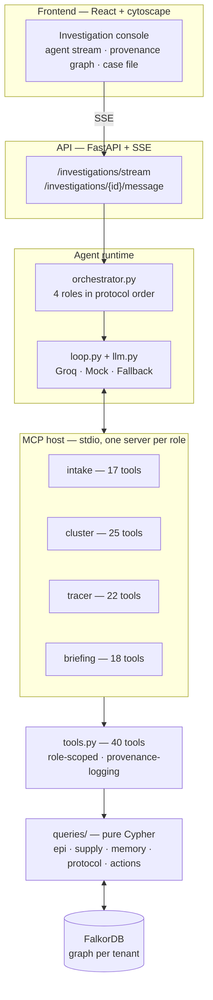

# BatchZero

[](https://github.com/ionfwsrijan/BatchZero/actions/workflows/ci.yml)
[](backend/tests)
[](backend/pyproject.toml)
[](backend/batchzero/api/app.py)
[](frontend)
[](https://falkordb.com)
[](docker-compose.yml)
[](LICENSE)

**An outbreak source-investigation agent that lives in a graph.**

When a cluster of foodborne illness appears, a public-health investigator has a
few hours to answer one question: *which lot of food, from which supplier, made
these people sick — and what do we do right now?* BatchZero runs that
investigation end to end. Four specialized agents (Intake Officer → Cluster
Analyst → Supply Chain Tracer → Briefing Officer) work the case in protocol
order, pulling every answer from **FalkorDB** and writing every conclusion back
as evidence attached to a hypothesis. Nothing is asserted without a traversal
behind it.

> **Graph Hacks 2026 · FalkorDB track · team ApexCoders**

---

## At a glance

| | |
|---|---|
| **Problem** | Trace 11 foodborne-illness cases to one lot + supplier, and act |
| **Answer** | Lot `MG-4417` (GreenLeaf Distributors) — **confirmed 0.96** |
| **Decoy** | Lot `LET-2210` tied at 11/11 cases — **refuted 0.05** |
| **Why it's a graph problem** | The tie is broken by a genomic match graph, not a count |
| **Stack** | FalkorDB · FastAPI + SSE · real MCP subprocesses · React + cytoscape |
| **Live** | <https://batchzero.onrender.com/> (free instance, ~60s cold start) |
| **Graph** | 26 labels · 40 relationship types · algorithms: betweenness, labelPropagation, SPpaths, WCC |
| **Agents** | 4 role-scoped sessions in protocol order, ~50 real tool calls per run |
| **Reproducible** | `python -m batchzero.demo.replay` → same answer, no API key |
| **Tests** | 36 passing offline against a live FalkorDB |

---

## Demo

**[Live demo → batchzero.onrender.com](https://batchzero.onrender.com/)** — the
whole stack (FalkorDB + agent + UI) in one container. Click **Run
investigation** and watch the four roles work. If the free instance has gone to
sleep, the first load takes ~60s to wake; it reseeds itself on boot, so the demo
is always in a known state.

**[Watch the 90-second demo](docs/demo.mp4)** (3840×2160 @ 60fps) — the problem, why the graph is
load-bearing, the architecture and data model, then the four-role protocol
running live against FalkorDB in the investigation console (streaming agent
steps, evidence network, epi curve, dark mode, follow-up questions), followed by
real benchmark and test output.

Reproduce it yourself in one command after `docker compose up`:

```bash
python -m batchzero.demo.replay --benchmark 3
```

---

## Why this is a graph problem (not decoration)

BatchZero is built so that removing FalkorDB doesn't just make it slower — it
makes it *impossible*. The graph is load-bearing at four levels:

1. **Epidemiology is a join.** "Which ingredient/facility/supplier is common to
   all 11 cases?" is an intersection over a trail of
   `Person → Case → ExposureEvent → MenuItem → Ingredient → Lot → Supplier`.
   In Cypher it is one pattern; in SQL it is a pile of self-joins.
2. **Traceability is traversal.** Following a suspicious lot upstream to its
   farm and downstream to every plate it reached is a variable-length path —
   the natural unit of a food recall.
3. **Graph algorithms earn their keep.** `algo.labelPropagation` finds exposure
   communities, `algo.betweenness` finds the structural chokepoint to inspect
   first, `algo.SPpaths` finds the shortest causal link between two entities,
   and the genomic match is a graph of isolate-to-isolate SNP distances.
4. **Provenance is a first-class graph.** Every claim the agent makes is a
   node. `Hypothesis -[:SUPPORTED_BY]-> Evidence -[:DERIVED_FROM]-> ToolCall
   -[:LOGGED]-> Session`. You can always walk from a confident conclusion back
   to the exact query that produced it.

---

## What it does

Given a cluster of 11 lab-confirmed *Salmonella* Enteritidis cases in the
(fictional) city of Port Meridian, the agent:

1. builds the **case file** and the shared-exposure picture (epi curve, common
   ingredients, facilities, upstream suppliers, exposure communities);
2. records **candidate hypotheses** and immediately hits the classic trap: two
   ingredients (*Microgreens Mix* and *Romaine Lettuce*) and two suppliers are
   **tied at 11/11 cases**. Counts cannot break the tie;
3. breaks it with **genomics** — the environmental isolate from lot `MG-4417`
   matches patient isolates across all 11 cases at ≤2 SNPs, while the
   `LET-2210` (lettuce) isolate matches **nothing**;
4. enforces **temporal hygiene** — one case's exposure record is logged
   *after* symptom onset and is rejected by the incubation-window check, so a
   stale row can't mislead the agent;
5. traces `MG-4417` upstream through its **shipment** and **farm**, audits the
   **cold chain** (a 12.8 °C breach on shipment `SH-2291`), checks supplier
   **history** (a 2025 incident with the same distributor);
6. **files the actions** — a **recall** scoped to `MG-4417`, inspection tasks
   assigned to real inspectors, and a distilled **institutional fact** for next
   time.

The result is a **confirmed hypothesis at 96% confidence**, a refuted decoy at
5%, and a decision brief where every sentence traces to a tool call.

---

## Architecture



The same system, as plain text (kept so it reads anywhere):

```
                         ┌─────────────────────────────────────────┐
                         │              FalkorDB (tenant graph)     │
                         │  cases · supply chain · evidence · memory │
                         └───────────────▲──────────────┬───────────┘
                                         │ Cypher        │ Cypher
      ┌──────────────────────────────────┼───────────────┴───────────────┐
      │                                   │                               │
┌─────┴──────┐   MCP (stdio)    ┌─────────┴────────┐   MCP (stdio)  ┌─────┴──────┐
│ MCP server │◀────────────────▶│  agent runtime  │◀──────────────▶│ MCP server │
│ role=intake│                  │   (4 roles in   │                │ role=...   │
│ 17 tools   │                  │  protocol order)│                │ 22 tools   │
└─────▲──────┘                  └────────┬────────┘                └─────▲──────┘
      │                                  │                               │
      │                       ┌──────────┴──────────┐                    │
      │                       │  tool layer (40)    │                    │
      │                       │  query layer (Cypher)│                   │
      │                       └─────────────────────┘                    │
      └───────────────────────────────  MCP host  ───────────────────────┘
                                        │
                              ┌─────────┴─────────┐
                              │  FastAPI + SSE     │──── React + cytoscape UI
                              └───────────────────┘
```

- **Role-scoped tools via real MCP.** Each role runs as its own
  `python -m batchzero.mcp_server` subprocess (stdio transport) exposing only
  its tool-set. The Intake Officer can open a case but cannot draft a recall;
  only the Briefing Officer can — and only the Tracer and Briefing roles can
  file tasks. Capability *is* the protocol step.
- **Provenance is automatic.** Every tool call is timed and written to the
  graph as a `ToolCall` node tied to the `Session`. Evidence cites the
  `tool_call_id` it came from, so the UI can replay the exact query behind any
  claim.
- **Deterministic by default.** With no LLM key the agent replays a scripted
  four-role plan (still 50 *real* MCP tool calls against FalkorDB); with
  `GROQ_API_KEY` set, Groq drives the same tool loop. Demos never break.

See [`docs/ARCHITECTURE.md`](docs/ARCHITECTURE.md) for the full design.

---

## Graph data model

40 relationship types across 26 node labels. The core investigation patterns:

| Path | Meaning |
|------|---------|
| `(Person)-[:HAS_CASE]->(Case)-[:LINKED_ISOLATE]->(Isolate)` | who got sick + the strain |
| `(Person)-[:PARTICIPATED]->(ExposureEvent)-[:AT]->(Facility)` | where they ate |
| `(ExposureEvent)-[:INVOLVES]->(MenuItem)-[:CONTAINS]->(Ingredient)` | what they ate |
| `(ExposureEvent)-[:CONSUMED]->(Lot)-[:SUPPLIED_BY]->(Supplier)` | the specific lot + supplier |
| `(Lot)-[:SHIPPED_IN]->(Shipment)-[:HAS_READING]->(TemperatureReading)` | cold chain |
| `(Lot)-[:ORIGINATES_FROM]->(Farm)` | farm of origin |
| `(Isolate)-[:MATCHES {snp_distance}]->(Isolate)` | genomic relatedness |

The agent's own memory is a second graph *on the same instance*:

| Path | Meaning |
|------|---------|
| `(Investigation)-[:HAS_HYPOTHESIS]->(Hypothesis)` | candidate sources |
| `(Hypothesis)-[:SUPPORTED_BY\|:CONTRADICTED_BY]->(Evidence)` | the case for/against |
| `(Evidence)-[:DERIVED_FROM]->(ToolCall)-[:LOGGED]->(Session)` | **the provenance chain** |
| `(Investigation)-[:HAS_RECALL]->(Recall)-[:COVERS]->(Lot)` | what we pulled |
| `(Fact)-[:FACT_ABOUT]->(Supplier)` | institutional memory across cases |
| `(ProtocolStep)-[:NEXT]->(ProtocolStep)`, `(Session)-[:AT_STEP]->(ProtocolStep)` | procedural memory |

Full label/relationship catalogue: [`docs/GRAPH_MODEL.md`](docs/GRAPH_MODEL.md).

---

## Key Cypher

**1 — shared-exposure intersection (the question only a graph answers well)**

```cypher
MATCH (c:Case)-[:INVOLVES|CONTAINS*..]->(ing:Ingredient)
WHERE c.case_id IN $case_ids
WITH ing, count(DISTINCT c) AS cases
WHERE cases = size($case_ids)          // present in EVERY case
RETURN ing.name AS ingredient, cases
ORDER BY cases DESC
```

**2 — genomic tie-break (why one lot wins and the other dies)**

```cypher
MATCH (l:Lot)-[:SAMPLED_FROM|:SHIPPED_IN*0..]->()<-[:LINKED_ISOLATE]-(c:Case)
// environmental isolate of the lot vs patient isolates, scored by SNP distance
MATCH (food:Isolate)-[:SAMPLED_FROM]->(l)
MATCH (food)-[m:MATCHES]->(patient:Isolate)
WITH l, collect(DISTINCT c.case_id) AS cases, min(m.snp_distance) AS min_snp
RETURN l.lot_id, size(cases) AS matched_cases, min_snp
ORDER BY matched_cases DESC, min_snp ASC
```

**3 — cold-chain breach, computed in-graph with `reduce`**

```cypher
MATCH (sh:Shipment {shipment_id:$id})-[:HAS_READING]->(r:TemperatureReading)
WITH sh, collect(r) AS readings
RETURN reduce(m = 0.0, x IN readings |
         CASE WHEN x.celsius > m THEN x.celsius ELSE m END) AS peak_c,
       [x IN readings WHERE x.celsius > 4.0 | x.at] AS excursions
```

**4 — structural chokepoint (graph algorithm, not a heuristic)**

```cypher
CALL algo.betweenness({}) YIELD node, score
WHERE score > 0
RETURN labels(node)[0] AS label, coalesce(node.lot_id, node.name, ...) AS ident,
       score ORDER BY score DESC LIMIT 10
```

**5 — provenance replay (the anti-hallucination guarantee)**

```cypher
MATCH (h:Hypothesis {hyp_id:$id})-[:SUPPORTED_BY]->(e:Evidence)
      -[:DERIVED_FROM]->(tc:ToolCall)-[:LOGGED]->(s:Session)
RETURN h.statement, e.summary, tc.tool, tc.ms, s.role
```

---

## Quickstart

Already have `make`? One line does steps 1–4 (`make falkordb install seed
replay`), and `make api` serves the API + UI. Otherwise:

```bash
# 1 — start FalkorDB (Redis protocol + FalkorDB Browser on :3000)
docker compose up -d falkordb

# 2 — backend
cd backend
python -m venv .venv
.\.venv\Scripts\Activate.ps1          # Windows; `source .venv/bin/activate` on *nix
pip install -e ".[dev]"

# 3 — seed the synthetic Port Meridian fixture + indexes
python -m batchzero.seed --reset

# 4 — watch the whole investigation run (reproducible, no API key needed)
python -m batchzero.demo.replay
python -m batchzero.demo.replay --benchmark 3   # correctness + latency metrics
python -m batchzero.demo.replay --live          # same loop, driven by a live LLM

# 5 — serve the API + UI
python -m batchzero.api.app            # http://localhost:8000
```

Frontend (dev server with hot reload):

```bash
cd frontend
npm install
npm run dev                            # http://localhost:5173
```

The API also serves the built UI at `/` after `npm run build`, so the whole
demo can run from a single process.

### Deploy it (one container, no external database)

`deploy/Dockerfile` builds a single image: FalkorDB + the API + the compiled UI.
The entrypoint starts the graph engine, seeds both tenants on boot, then serves
the app on `$PORT`.

```bash
docker build -f deploy/Dockerfile -t batchzero .
docker run --rm -p 8000:8000 batchzero        # http://localhost:8000
```

`render.yaml` is a ready blueprint for a free Render web service (Singapore);
the instance type, region, and health check (`/api/health`) are all it needs.
The hosted instance runs this image at <https://batchzero.onrender.com/> — free
tier sleeps after ~15 minutes idle, so the first request after that takes ~60s
to wake (it reseeds itself on boot).

---

## Judge quick commands

- **Watch live investigation**: `python -m batchzero.demo.replay` (no key)
- **Benchmark (reproducible)**: `python -m batchzero.demo.replay --benchmark 3`
- **Live LLM mode**: `python -m batchzero.demo.replay --live` (falls back gracefully on 429)
- **Run full API + UI**: `python -m batchzero.api.app` (`http://localhost:8000`)
- **All tests**: `pytest -q` (36 passing, offline)

**Read next:** [`docs/SUBMISSION.md`](docs/SUBMISSION.md) (judge guide + rubric
map) · [`docs/ARCHITECTURE.md`](docs/ARCHITECTURE.md) (diagrams) ·
[`docs/GRAPH_MODEL.md`](docs/GRAPH_MODEL.md) (full catalogue).

## Configuration

Copy `.env.example` to `.env`. To use a live LLM:

```
LLM_PROVIDER=groq
GROQ_API_KEY=gsk_...
GROQ_MODEL=openai/gpt-oss-120b
```

The agent runs on Groq's OpenAI-compatible endpoint and falls back to the
deterministic plan automatically if the provider errors (e.g. a free-tier
`429`), so a live run is never interrupted. With no key configured,
`LLM_PROVIDER` resolves to `mock` and the deterministic plan drives the loop —
the same MCP tool calls against the same graph, fully offline.

---

## Tests

```bash
cd backend
pytest -q
```

| Suite | What it proves |
|-------|----------------|
| `test_queries.py` | the query layer returns the *investigative* answer (correct lot, correct tie, temporal rejection) |
| `test_mcp.py` | role-scoped tool discovery over a real stdio MCP subprocess + provenance logging |
| `test_agent.py` | the full four-role run: main hypothesis confirmed, decoy refuted, evidence tool-attributed, recall + tasks filed |
| `test_api.py` | read endpoints + the SSE investigation stream |

All 36 tests run offline against a live FalkorDB (the LLM is pinned to the
deterministic plan).

---

## Multi-tenant by construction

FalkorDB stores each graph under its own key. BatchZero gives every agency a
graph: `pmph_ops` (the live case file) and `training_academy` (an isolated
sandbox). The tenant name is threaded through the DB layer and injected into
each MCP subprocess via `BATCHZERO_TENANT`, so a session can never read across
tenants.

---

## Project layout

```
batchzero/
├─ backend/
│  ├─ batchzero/
│  │  ├─ db.py            # FalkorDB layer (query / ro_query / serialization)
│  │  ├─ schema.py        # labels, relationships, indexes, incubation windows
│  │  ├─ seed.py          # synthetic Port Meridian fixture (134 nodes, 197 edges)
│  │  ├─ queries/         # pure Cypher functions (epi, supply, memory, protocol, actions)
│  │  ├─ tools.py         # 40 tools + role-scoped tool-sets
│  │  ├─ mcp_server.py    # stdio MCP server (role instructions, dynamic schemas)
│  │  ├─ mcp_client.py    # agent-side MCP session
│  │  ├─ agent/           # llm, prompts, scripts, loop, orchestrator
│  │  ├─ api/             # FastAPI + SSE
│  │  └─ demo/replay.py   # live transcript + benchmark
│  └─ tests/
├─ frontend/              # React + cytoscape investigation console
├─ docs/                  # submission guide, architecture, graph model
├─ deploy/                # single-container image + entrypoint (FalkorDB + API + UI)
├─ render.yaml            # hosted-demo blueprint (free Render web service)
├─ Makefile               # one-word targets for common tasks
├─ .github/workflows/ci.yml  # CI: backend tests + frontend build
└─ docker-compose.yml     # FalkorDB (+ Browser) for local development
```

---

## License

MIT — see [LICENSE](LICENSE).
