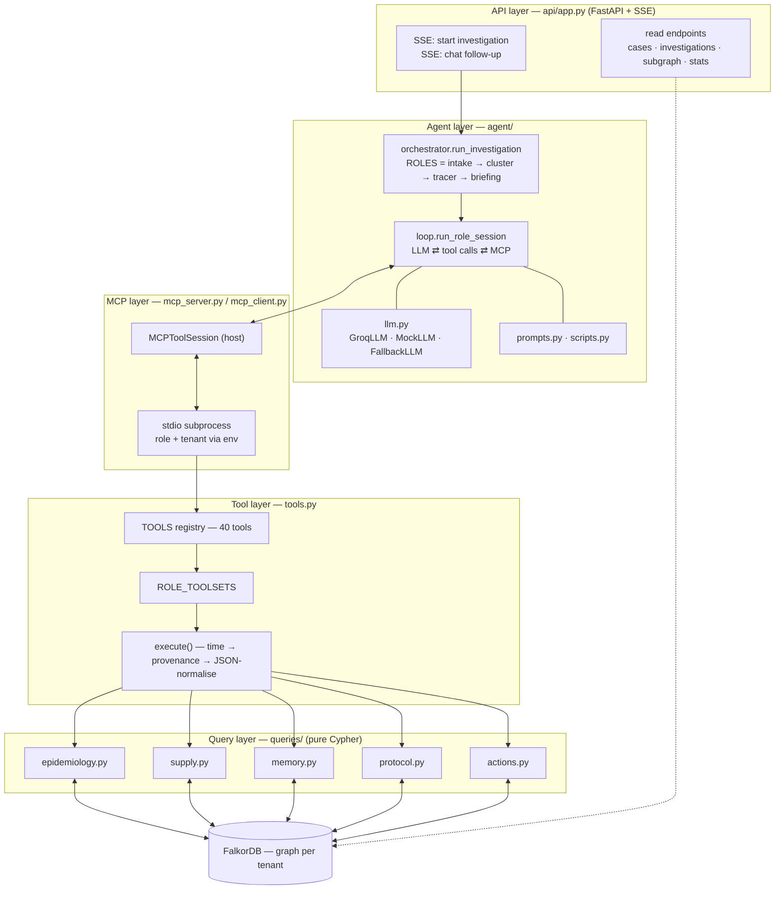
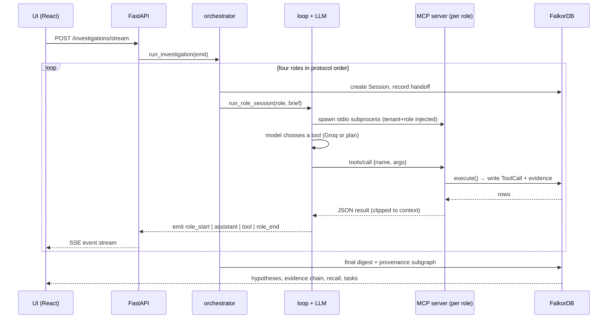

# BatchZero — Architecture

BatchZero is layered so that each concern is independently testable and so the
graph stays the single source of truth.

## The layers, rendered

## One investigation, as a sequence

## 1. DB layer (`db.py`)

A thin wrapper over the FalkorDB client. `query` runs reads/writes, `ro_query`
runs server-side read-only queries. Results are normalized to plain dicts and
all FalkorDB temporal/object values are serialized to JSON-safe Python.

**FalkorDB notes discovered while building** (documented because they shaped the
query layer):

- results arrive with a header of `[type_code, name]` pairs — flattened to
  column names before building row dicts;
- temporal values come back as `datetime.date`;
- use `localdatetime()` not `datetime()`, and `date($param)` to pass dates;
- `algo.pageRank` needs exactly two args (label, relType); `WCC` /
  `labelPropagation` reject `relTypes`;
- undirected `shortestPath` is unsupported — `algo.SPpaths({... relDirection:
  'both'})` is used instead;
- `max([x IN list | ...])` returns the list, not a scalar — scalar peak/min are
  computed with `reduce(...)`;
- `collect()` of a map literal yields a phantom all-null row when the match is
  optional, so collects are guarded with `CASE WHEN x IS NULL THEN NULL ELSE
  {...} END`.

## 2. Query layer (`queries/`)

Pure Cypher functions grouped by concern. Each returns a `QueryOutcome` that
carries the **rows, the Cypher, the params, latency and (where used) the graph
algorithm**. That provenance is what the tool layer writes into the graph as
evidence. There is no ORM and no cache: every answer is a live traversal, which
is the point.

- `epidemiology.py` — cases, epi curve, common-exposure intersections,
  temporal fit, genomic ranking, isolate matching;
- `supply.py` — supply-chain traces, cold chain (reduce-based), betweenness
  chokepoints, connected components, shortest link, supplier/facility dossiers;
- `memory.py` — semantic recall, prior incidents, subgraph extraction, the
  investigation digest/state, graph stats;
- `protocol.py` — the protocol steps and incubation windows as data;
- `actions.py` — every write: open investigation, add/update hypothesis, attach
  evidence, create task, draft recall, remember fact, record sessions/messages,
  log tool calls, handoff.

## 3. Tool layer (`tools.py`)

40 tools registered in a `TOOLS` dict. A tool wraps a query function, is
executed through `execute(ctx, name, args)` which:

1. times the call,
2. writes a `ToolCall` node linked to the current `Session` (provenance),
3. normalizes the payload to JSON-safe values (so it survives the MCP
   transport and round-trips back as JSON),
4. injects `ok`, `tool`, `ms`, and `tool_call_id`.

`ROLE_TOOLSETS` maps each role to a capability surface:

| role | what it may do |
|------|----------------|
| `intake` | open the case, read epi/exposure, attach cases, set stage |
| `cluster` | everything intake can + genomics, hypotheses, evidence |
| `tracer` | supply trace, cold chain, chokepoints, create tasks |
| `briefing` | recall, facts, summary, the decision actions |

The **Briefing Officer can `draft_recall`; the Cluster Analyst cannot.** The
protocol is enforced by the tool surface, not by prompt willpower.

## 4. MCP layer (`mcp_server.py`, `mcp_client.py`)

Each role is a **real MCP server subprocess** over stdio
(`mcp.server.mcpserver.MCPServer`). The server exposes only the role's tools and
carries role-specific `instructions`. Tenancy/session/role/investigation are
injected through environment variables (`BATCHZERO_TENANT`, `BATCHZERO_ROLE`,
`BATCHZERO_SESSION_ID`, `BATCHZERO_INVESTIGATION_ID`), so the server process is
stateless and the agent-side `MCPToolSession` simply spawns it.

Two non-obvious implementation details:

- the MCP `Tool` object is patched with the JSON schema *and* a matching
  `FuncMetadata(arg_model=...)`, otherwise FastMCP/MCPServer validates calls
  against the generic `(*args, **kwargs)` signature instead of our schema;
- the client parses the server's JSON text content back into a dict, which is
  what the agent loop feeds to the LLM and what the mock plan reads from.

## 5. Agent layer (`agent/`)

- `llm.py` — a single `BaseLLM.complete(messages, tools)` interface with a
  `GroqLLM` (OpenAI-compatible) and a `MockLLM` that replays a deterministic
  plan. `make_llm` picks Groq when a key exists, otherwise the scripted plan.
- `prompts.py` — role objectives, the output contract, glossary, handoff notes.
- `scripts.py` — the deterministic four-role plans (the offline "brain").
- `loop.py` — `run_role_session`: records the session + handoff + user message,
  opens an MCP session, runs the LLM tool loop (LLM → tool calls → MCP →
  back into context), emits `role_start`/`assistant`/`tool`/`role_end`, records
  the final message.
- `orchestrator.py` — runs the four roles in protocol order, threads each role's
  brief into the next role's task via the graph-backed `HANDOFF`, and is what
  the API drives. `route_role` sends chat follow-ups to the right role.

Because the mock and the live model share the loop, switching from a scripted
demo to a live LLM changes *who decides* the next tool, not how the graph is
read or written.

## 6. API + UI (`api/app.py`, `frontend/`)

FastAPI exposes read endpoints (cases, investigations, the provenance
sub-graph, graph summary, role tools) and two **SSE** endpoints that stream the
orchestrator's events live: start an investigation, or send a follow-up. The
React console (Vite + cytoscape) renders three panes: the live agent activity,
the provenance graph, and the case file (hypotheses with evidence, recall,
tasks, brief).

## Determinism & testing

`test_queries` asserts investigative answers; `test_mcp` proves role-scoping and
provenance over a real subprocess; `test_agent` runs the whole investigation and
checks the science (confirmed/refuted, evidence attribution, recall scope);
`test_api` covers the HTTP + SSE surface. `demo/replay.py --benchmark N`
reproduces correctness and latency from a clean graph.
